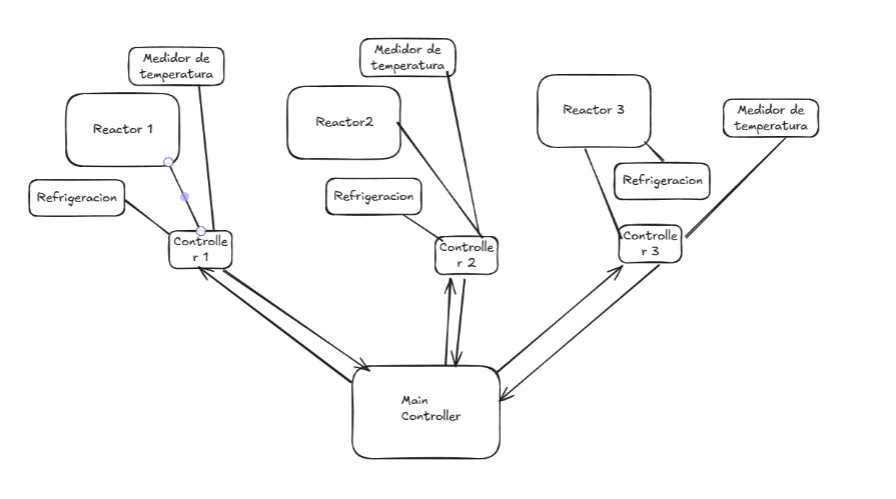

**Universidad de Ingenieria y Tecnologia**

**Departamento de Ciencias de la Computación**

**Arquitectura de Software**

**Caso de Estudio \#12**

**2026 - II**

| **TEAM**        |             |
|-----------------|-------------|
| **INTEGRANTES** |             |
| **Puntos**      | **20 ptos** |

**Background:**

Reliability Patterns

Fault Tolerance

Legacy Migration

Scalability

**Caso de Estudio: Save Chernobyl ( medium )**

Usted ha sido contratad@ para implementar un sistema de control de una
planta nuclear que tiene 3 reactores funcionales. El problema es que el
sistema legacy funciona pero el control se hace demasiado manual lo cual
dificulta el control de la planta y genera pérdidas de tiempo en los
empleados.

**Requerimientos Funcionales:**

- Cada medidor de temperatura debe enviar datos periódicamente. El envio
  en promedio es de 0.05s.

- Cada reactor podría tener un controlador local que gestione
  refrigeración y alertas.

- El *Main Controller* debe recibir datos, tomar decisiones globales y
  enviar comandos.

- Panel para operadores con visualización en tiempo real, alarmas y
  reportes.

- Alertas si la temperatura supera umbrales.

- ¿Qué pasa si un sensor falla? ¿Qué pasa si el controlador central se
  desconecta?

- Registro de todas las acciones y datos para trazabilidad. Quien
  prendio o apago que ?

- Un arquitecto de otra area reporto que hay una libreria nueva para el
  manejo de eventos que mejoraria la latencia. Considere esta posible
  variante o piloto a iniciar.

**Requerimientos NO Funcionales:**

- Disponibilidad y tolerancia a fallos.

- Tiempo real (latencia mínima para decisiones
  críticas).

**Entregables**

- Diagrama de Arquitectura con reliability y fault tolerance.

- Defina criterios hipoteticos de escalabilidad. Hipoteticos ya que aun
  no tenemos data disponible para decidir.

**Hints/Tips:**

- Identifique los SPOF.

**Restricciones:**

- Tenga en cuenta que hay interacciones con sensores y controladores. Y
  muy importante <u>que cualquier decisión errónea puede causar un
  desastre.</u>

- El sistema actual controla los reactores y no puede ser reemplazado
  completamente ni detenido durante la modernización. La nueva
  arquitectura debe coexistir temporalmente con componentes legacy.

- Cada reactor puede incorporar hasta 100 sensores, cada uno generando
  mediciones periódicamente.

- Considere Failure Scenarios. El sensor deja de responder ?
